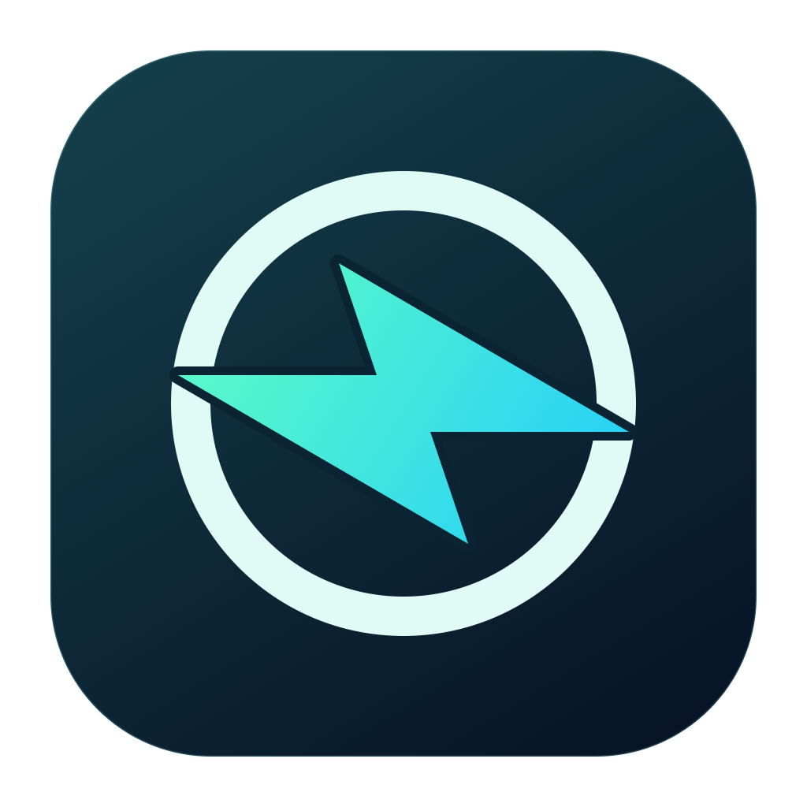
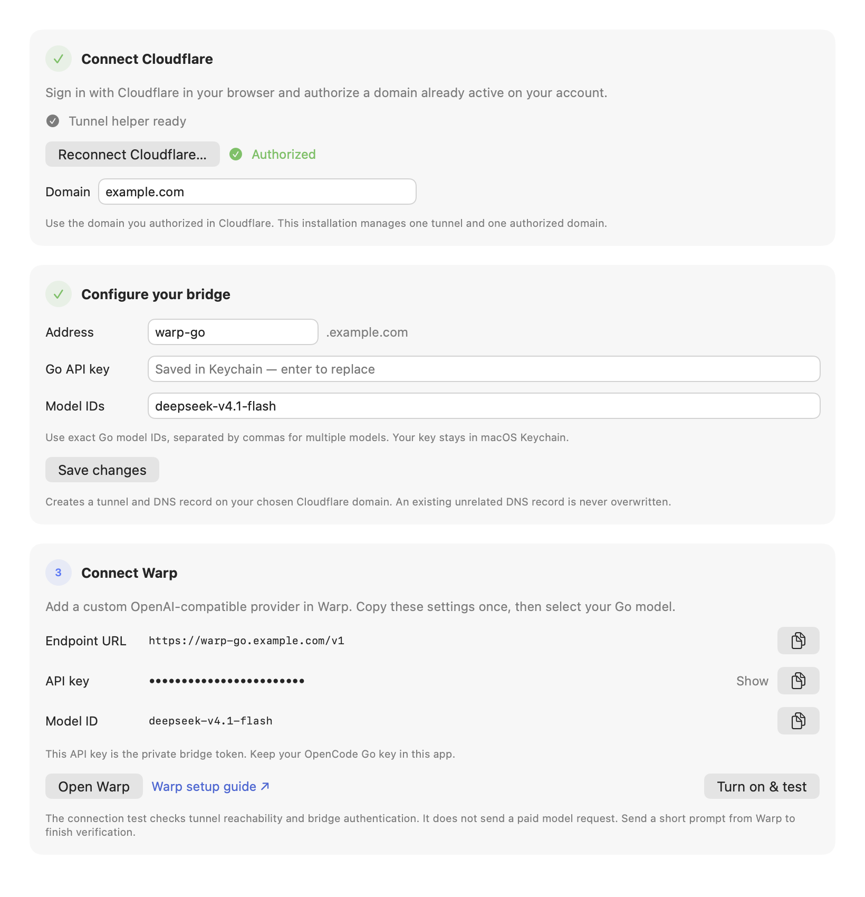

<p align="center">
  
</p>

<h1 align="center">Warp OpenCode Bridge</h1>

<p align="center">
  Your OpenCode Go subscription, connected to Warp.<br />
  A native macOS app with a simple menu bar switch.
</p>

<p align="center">
  
  
  <a href="https://github.com/dedkola/warp-opencode/actions/workflows/ci.yml"></a>
  <a href="LICENSE"></a>
</p>

<p align="center">
  <a href="https://github.com/dedkola/warp-opencode/releases"><strong>Download for Mac</strong></a> ·
  <a href="#quick-setup">Quick setup</a> ·
  <a href="docs/GUIDE.md#troubleshooting">Get help</a> ·
  <a href="#development">Development</a>
</p>

## What is it?

Warp OpenCode Bridge lets you use an **OpenCode Go subscription inside Warp**. It runs on your Mac, connects Warp to Go through Cloudflare Tunnel, and gives you one switch to turn the connection on or off.

## Why use it?

- **Keep working in Warp.** Use your Go models through Warp's custom inference settings.
- **Skip the server setup.** Cloudflare Tunnel provides an HTTPS address without a VPS or port forwarding.
- **Set it up in one window.** Connect Cloudflare, add your Go key, and copy the ready-to-use settings into Warp.
- **Control it from the menu bar.** Start or stop the bridge whenever you need it.
- **Keep keys in Keychain.** Warp gets a separate bridge token; your Go API key stays in the app's Keychain storage.

```text
Warp → Cloudflare Tunnel → Bridge on your Mac → OpenCode Go
```

Warp sends custom inference requests from its servers, so it needs the public HTTPS address supplied by Cloudflare. **Keep your Mac awake and online while using the bridge.** See [how it works](docs/GUIDE.md#how-it-works) for the full connection path.

## A look at Settings

<p align="center">
  
</p>

<p align="center"><em>The native Setup panel, rendered with example values: connect Cloudflare, configure your bridge, and connect Warp. Keys stay hidden.</em></p>

## Before you start

| You need | Details |
| --- | --- |
| A Mac | macOS 14 or later, Apple silicon or Intel. |
| Warp | A version with custom inference endpoint support. |
| OpenCode Go | An active subscription and its API key. |
| Cloudflare | An active domain managed in your account, with permission to create a tunnel and DNS record. Choose an unused subdomain. |

The download includes the Cloudflare helper. You do not need Xcode, Swift, or Homebrew to use the app. Cloudflare's standard account and service limits apply.

## Download and install

1. Open [GitHub Releases](https://github.com/dedkola/warp-opencode/releases) and choose the DMG for your Mac:

   | Your Mac | Download ending in |
   | --- | --- |
   | Apple silicon — M1 or newer | `arm64.dmg` |
   | Intel | `x86_64.dmg` |

2. Open the DMG and drag **Warp OpenCode Bridge.app** into **Applications**.
3. Eject the DMG, then open the app from Applications.

> [!IMPORTANT]
> Downloads are **not Developer ID signed or notarized**. If macOS blocks the first launch, go to **System Settings → Privacy & Security → Open Anyway** for this app. See [Apple's guidance](https://support.apple.com/en-us/102445).

<details>
<summary>Alternative first-launch method and download checksums</summary>

The DMG includes **First Launch.txt**. For a download you trust, its app-specific Terminal method is:

```sh
xattr -dr com.apple.quarantine "/Applications/Warp OpenCode Bridge.app"
open "/Applications/Warp OpenCode Bridge.app"
```

This removes quarantine from this app and its bundled helper without changing Gatekeeper globally. Subsequent launches work normally.

ZIP downloads are also available. To verify a download, get `SHA256SUMS` from the same release, run `shasum -a 256 <downloaded-file>`, and compare the result with its entry.

</details>

## Quick setup

Open **Settings → Setup** from the app's menu bar item. You can also click its Dock icon or press **⌘,** while the app is active.

### 1. Connect Cloudflare

Click **Connect Cloudflare…**, sign in in your browser, and authorize the domain you want to use. Back in the app, check **Domain**. If it was not filled in automatically, enter the domain you authorized, such as `example.com`.

### 2. Configure your bridge

Fill in these fields under **Configure your bridge**:

| App field | What to put there | Example |
| --- | --- | --- |
| **Domain** | Your domain managed in Cloudflare, without `https://` or a path. This field is in step 1. | `example.com` |
| **Address** | An unused subdomain name. Enter only the part before your domain. | `warp-go` → `warp-go.example.com` |
| **Go API key** | Your OpenCode **Go** API key. | Paste your key here. |
| **Model IDs** | Exact Go model IDs. Separate multiple models with commas. | `deepseek-v4.1-flash` is the app's default. |

Click **Create bridge**. The app saves your key in Keychain, generates a separate bridge access token, and creates the Cloudflare tunnel and DNS record. After setup, this button becomes **Save changes**.

### 3. Copy the settings into Warp

Under **Connect Warp**, click **Turn on & test**. Then add a custom OpenAI-compatible provider in Warp using the app's copy buttons:

| Warp setting | Copy from the app |
| --- | --- |
| **API / base URL** | **Endpoint URL**, for example `https://warp-go.example.com/v1`. |
| **API key** | **API key** under **Connect Warp** — this is the generated bridge token. |
| **API format**, if asked | OpenAI-compatible chat completions. |
| **Model** | One **Model ID** shown under **Connect Warp**. |

> [!TIP]
> **Two keys, two places:** your OpenCode Go key goes in the bridge app. The generated bridge API key goes in Warp.

Warp's labels may vary. If it asks for a complete chat-completions URL, use your endpoint followed by `/chat/completions`, for example `https://warp-go.example.com/v1/chat/completions`. See [Warp's setup guide](https://docs.warp.dev/agents/inference/custom-inference-endpoint).

Select your configured model in Warp, start a **new chat**, and send a short prompt followed by a follow-up. The app's connection test checks the public tunnel and bridge authentication without making a paid model request; a reply in Warp confirms the full connection to Go.

Keep the Cloudflare hostname free of browser login challenges. Warp's servers cannot complete an interactive login; the bridge token protects inference access.

## Everyday use

| To… | Do this |
| --- | --- |
| Start or stop the bridge | Use the menu bar switch. **On** starts the local proxy and tunnel; **Off** stops them. |
| Open Settings | Click the Dock icon, choose Settings from the menu bar, or press **⌘,** while the app is active. |
| Use a different provider | Select another model in Warp. The bridge does not change Warp's model selection. |
| Close Settings | Close the window; the app and bridge keep running. |
| Exit completely | Choose **Quit** to stop the app and its processes. |

**Conversations:** leave routing on **Automatic** to start. Turning the bridge Off and On preserves chat routing while the app stays open. After quitting/reopening the app, changing routing mode, or resetting routing history, start a new Warp chat if Warp does not send a conversation ID. Trimmed history, forked chats, and exact retries can also need special handling; see the [conversation guide](docs/GUIDE.md#conversation-sessions).

Stopping or quitting does not remove the tunnel or DNS record from Cloudflare. The app manages its own helper processes and leaves unrelated tunnels and your existing `~/.cloudflared` setup alone.

## Need a hand?

| Problem | Try this first |
| --- | --- |
| Warp reports an authorization error | Copy the **bridge API key** again and check the exact endpoint URL. |
| HTTP 530 just after starting | Wait briefly, then click **Test connection** again. |
| HTTP 409 / session error | Start a distinct new Warp chat. See [conversation sessions](docs/GUIDE.md#conversation-sessions) for retry and routing details. |
| Local checks pass, but Warp fails | Check the public tunnel, Warp's selected model, and your Go subscription. |
| Requests stop when the lid closes | Keep this Mac awake and connected. |

More help: [Troubleshooting](docs/GUIDE.md#troubleshooting) · [Credentials and data](docs/GUIDE.md#credentials-and-data) · [Report an issue](https://github.com/dedkola/warp-opencode/issues)

When reporting an issue, include your macOS version, bridge version, and redacted error text. Keep keys, tokens, Cloudflare credentials, and conversation content out of screenshots and reports.

This is an independent project, unaffiliated with Warp, OpenCode, or Cloudflare. Released under the [MIT license](LICENSE); see [third-party notices](THIRD_PARTY_NOTICES.md).

## Development

Use **macOS 14+** and a **Swift 6 toolchain**. From a fresh checkout:

```sh
git clone https://github.com/dedkola/warp-opencode.git
cd warp-opencode

# Build the app with its bundled Cloudflare helper.
scripts/build-app.sh

# Open the native app.
open "build/Warp OpenCode Bridge.app"
```

Run the core tests without a Go subscription or Cloudflare account:

```sh
# Full Xcode: normal XCTest suite.
scripts/test.sh

# Command Line Tools only: same test bodies with a portable assertion adapter.
scripts/test.sh --portable
```

The portable checks are a separate runner, not XCTest. Both commands fetch a pinned, checksum-verified helper on first run; helper configuration validation is offline and creates no tunnel or DNS record. Building and testing locally does not publish a release.

For a DMG, run `scripts/build-dmg.sh`. CI runs native XCTest and package verification on Apple silicon and Intel; matching version tags publish releases after both builds pass.

[Development and packaging guide](docs/DEVELOPMENT.md) · [Contributing](CONTRIBUTING.md) · [Release instructions](docs/RELEASING.md) · [Changelog](CHANGELOG.md)
